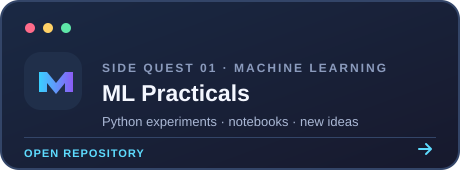
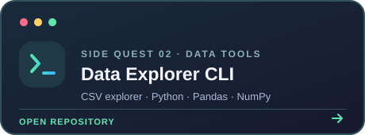
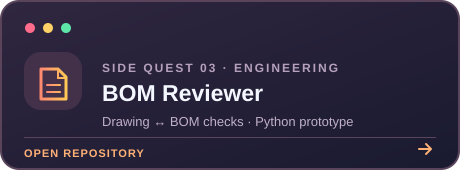

<!-- Hey there! This is the profile README for github.com/tanshu2806 -->

 

---

## 🤖 Human currently teaching machines

🎓 Engineering student, Python tinkerer, and aspiring ML explorer  
🧠 Currently learning **machine learning, AI, and deep learning**  
🔧 Building projects around data and intelligent systems  
🌐 Also learning web development, because apparently one rabbit hole wasn't enough  
☕ Current research question: *Can this model learn the pattern, or did I just teach it my mistakes?*

## 🎮 Projects in the wild

  
  

  

## 🐍 The contribution snake

<picture>
  <source media="(prefers-color-scheme: dark)" srcset="https://raw.githubusercontent.com/tanshu2806/tanshu2806/output/github-contribution-grid-snake-dark.svg" />
  <source media="(prefers-color-scheme: light)" srcset="https://raw.githubusercontent.com/tanshu2806/tanshu2806/output/github-contribution-grid-snake.svg" />
  
</picture>

## 🧰 My tech loot

*Tools and technologies showing up across my projects — still leveling up.*

### 🧠 ML, AI & data

### 🌐 Web & apps

### 🔎 Search, storage & AI APIs

### 🛠️ Everyday tools

---

### ✨ Thanks for visiting my little corner of GitHub!

*May your models converge and your bugs be easy to Google.*

